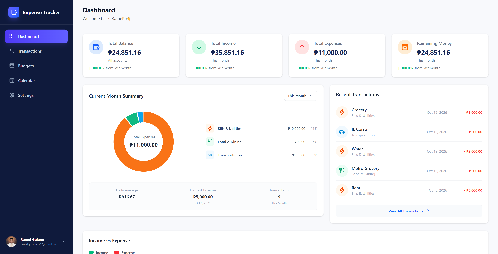
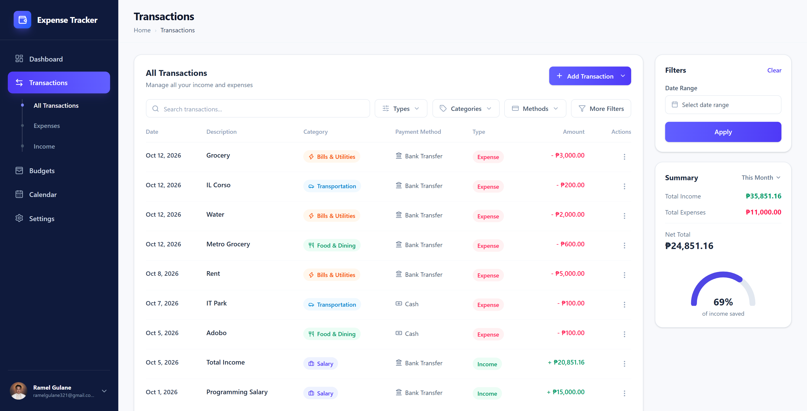
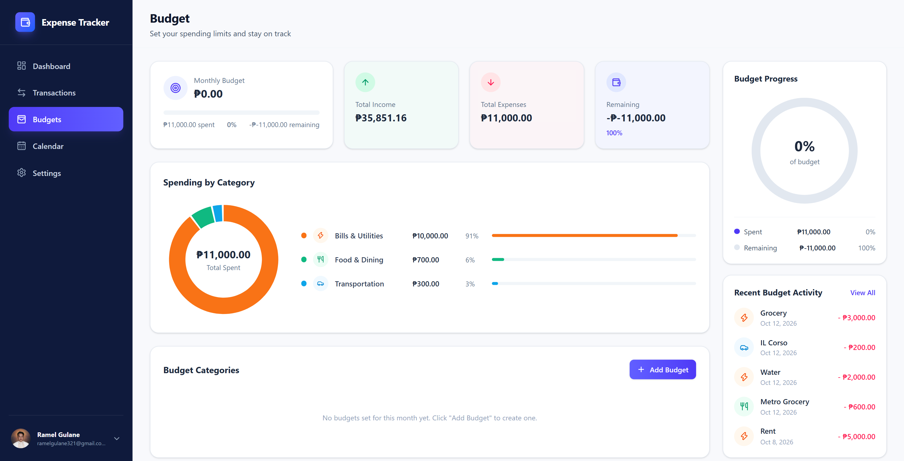
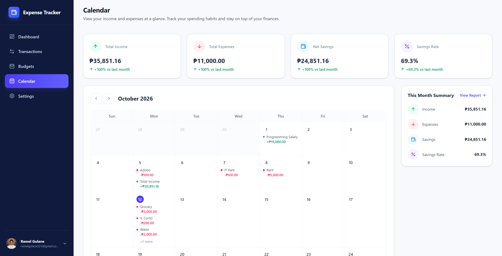
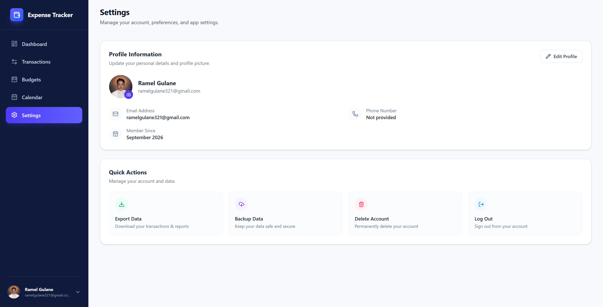

# Expense Tracker

A personal finance web app for tracking income and expenses, setting monthly budgets per category, and seeing where your money goes. It is built with React, Clerk, and Supabase, and has no separate backend.

**Live demo:** https://expensetrackeramel.netlify.app/

## Screenshots

| Dashboard | Transactions |
| --- | --- |
|  |  |

| Budget | Calendar |
| --- | --- |
|  |  |

| Settings |
| --- |
|  |

## Features

**Transactions**
- Add, edit, and delete income and expense transactions, with a confirmation before deleting
- Assign each transaction a category and payment method
- Search by description, category, payment method, or amount
- Filter by type, category, payment method, and date range
- Paginated list (10 per page), plus separate Expenses and Income views
- Expenses larger than your current balance are blocked

**Dashboard**
- Summary cards for total balance, income, expenses, and remaining money, compared with last month
- Spending-by-category donut chart that switches between this week, this month, and this year
- Daily average, highest expense, and transaction count
- Income vs expense bar chart for the current month
- Your most recent transactions

**Budgets**
- One monthly budget per category
- Spent, remaining, and progress for each budget, with an On Track, Near Limit, or Over Budget status
- Overall budget progress and spending-by-category breakdown

**Calendar**
- Month view showing each day's income and expenses
- Previous and next month navigation
- Monthly totals, net savings, and savings rate compared with the previous month

**Account**
- Sign up and sign in with Clerk
- Profile page with your name, email, and join date, and the option to change your profile photo
- Log out

## Tech Stack

| Area | Tools |
| --- | --- |
| Frontend | React, Vite, React Router |
| Styling | Tailwind CSS |
| Authentication | Clerk |
| Database | Supabase (PostgreSQL) with row-level security |
| Charts | Recharts |
| Utilities | date-fns, react-day-picker, lucide-react, sonner |
| Hosting | Netlify |

## How It Works

There is no custom server. The React app talks to Supabase directly from the browser:

1. Clerk handles sign-in and issues a session token.
2. The app creates a Supabase client that sends that token with every request (`src/hooks/useSupabaseClient.js`).
3. Supabase verifies the token through its Clerk third-party auth integration.
4. Row-level security policies compare each row's `user_id` with the token's `sub` claim, so every user can only read and change their own transactions and budgets.

## Project Structure

```
Expense-Tracker/
└── frontend/
    ├── src/
    │   ├── components/   # layout, dashboard, transactions, budgets, calendar, settings, shared UI
    │   ├── pages/        # Dashboard, Transactions, Budgets, Calendar, Settings, Login, Signup
    │   ├── hooks/        # useSupabaseClient (attaches the Clerk session token)
    │   ├── services/     # Supabase queries for transactions, categories, and budgets
    │   ├── utils/        # summary, budget, and calendar calculations
    │   └── App.jsx       # routes
    └── package.json
```

## Getting Started

### Prerequisites

- A recent version of Node.js (20.19 or newer recommended)
- A [Supabase](https://supabase.com) project
- A [Clerk](https://clerk.com) application

### 1. Clone and install

```bash
git clone https://github.com/Ramelzkie96/Expense-Tracker.git
cd Expense-Tracker/frontend
npm install
```

### 2. Set up the database

Run the SQL below in the Supabase SQL Editor. `categories` and `payment_methods` are shared lookup tables, so you need to add your own rows to them (for example Food & Dining, Salary, Cash, Bank Transfer).

```sql
create table public.categories (
  id uuid primary key default gen_random_uuid(),
  name text not null unique,
  type text not null,          -- 'income' or 'expense'
  icon_name text not null,     -- a lucide-react icon name, e.g. 'Utensils'
  icon_bg text not null,       -- Tailwind class, e.g. 'bg-emerald-50'
  icon_color text not null,    -- Tailwind class, e.g. 'text-emerald-600'
  created_at timestamptz default now()
);

create table public.payment_methods (
  id uuid primary key default gen_random_uuid(),
  name text not null unique,
  icon_key text not null,      -- a lucide-react icon name, or an image key when is_image is true
  is_image boolean not null default false,
  icon_bg text not null,
  icon_color text,
  created_at timestamptz default now()
);

create table public.transactions (
  id uuid primary key default gen_random_uuid(),
  user_id text not null,       -- Clerk user id (the token's "sub" claim)
  type text not null check (type in ('Income', 'Expense')),
  amount numeric not null,
  title text not null,
  subtitle text,
  category_id uuid not null references public.categories(id),
  payment_method_id uuid not null references public.payment_methods(id),
  transaction_date date not null,
  transaction_time time,
  notes text,
  created_at timestamptz default now()
);

create table public.budgets (
  id uuid primary key default gen_random_uuid(),
  user_id text not null,
  category_id uuid not null references public.categories(id),
  monthly_budget numeric not null,
  start_date date not null,
  end_date date,
  description text,
  created_at timestamptz not null default now(),
  unique (user_id, category_id)
);

-- Row-level security
alter table public.categories enable row level security;
alter table public.payment_methods enable row level security;
alter table public.transactions enable row level security;
alter table public.budgets enable row level security;

-- Lookup tables: readable by signed-in users
grant select on public.categories, public.payment_methods to authenticated;
create policy "read categories" on public.categories for select using (true);
create policy "read payment methods" on public.payment_methods for select using (true);

-- Per-user tables: each user can only touch their own rows
grant select, insert, update, delete on public.transactions, public.budgets to authenticated;

create policy "own transactions" on public.transactions
  for all using (user_id = auth.jwt()->>'sub')
  with check (user_id = auth.jwt()->>'sub');

create policy "own budgets" on public.budgets
  for all using (user_id = auth.jwt()->>'sub')
  with check (user_id = auth.jwt()->>'sub');
```

### 3. Connect Clerk and Supabase

1. In the Clerk Dashboard, open the Supabase integration setup and activate it. This adds the `role: "authenticated"` claim to Clerk's session token.
2. In Supabase, go to **Authentication > Sign In / Providers > Third-Party Auth**, add **Clerk**, and enter your Clerk domain.

### 4. Add environment variables

Create a `.env` file inside `frontend/`:

```env
VITE_SUPABASE_URL=https://your-project-ref.supabase.co
VITE_SUPABASE_ANON_KEY=your-supabase-publishable-key
VITE_CLERK_PUBLISHABLE_KEY=your-clerk-publishable-key
```

Only publishable keys belong in the frontend. Never put a Supabase secret key in this file.

### 5. Run the app

```bash
npm run dev
```

Open http://localhost:5173.

## Scripts

| Command | Description |
| --- | --- |
| `npm run dev` | Start the development server |
| `npm run build` | Create a production build in `dist/` |
| `npm run preview` | Preview the production build locally |
| `npm run lint` | Run ESLint |

## Deployment

The app is deployed on Netlify as a static site.

- **Base directory:** `frontend`
- **Build command:** `npm run build`
- **Publish directory:** `frontend/dist`
- **Environment variables:** the three `VITE_` variables above
- **Redirects:** a rule that serves `index.html` for every path (`/*  /index.html  200`), so React Router routes work on refresh

For production, use a Clerk production instance and add your live domain to it, instead of the development keys.

## Roadmap

- Export data (CSV)
- Backup data
- Delete account

## Author

**Ramel Gulane** - [@Ramelzkie96](https://github.com/Ramelzkie96)
